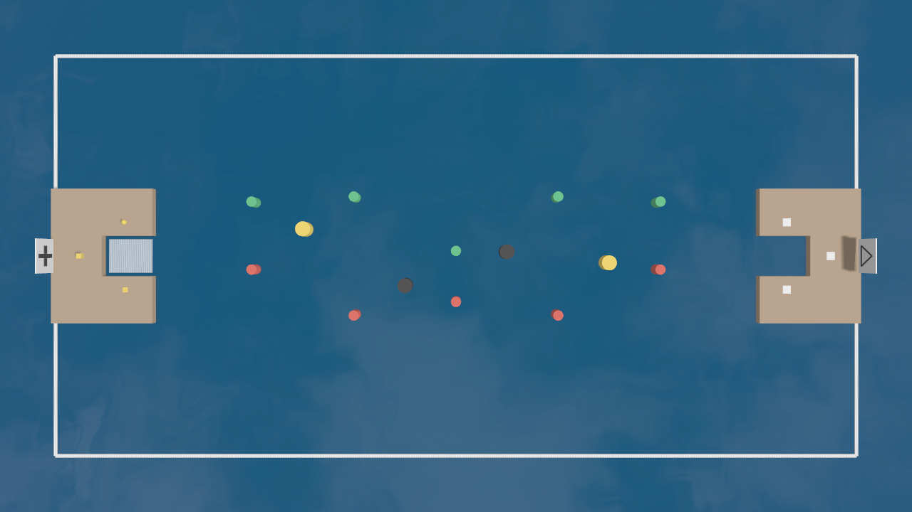

# Arena latihan di VRX (Gazebo)

Arena dengan dua dermaga, jalur buoy hijau dan merah, rintangan, dan tiga barang. Dipakai untuk latihan navigasi, deteksi, dan kontrol di Gazebo.

## Isi
- `pengiriman_kapal_otonom.sdf`: arena skala asli (kolam 24 x 12 m)
- `pengiriman_kapal_otonom_x5.sdf`: semua ukuran dikali 5, untuk WAM-V bawaan VRX (panjang sekitar 5 m)
- `jalankan_arena.sh`: menjalankan arena saja
- `jalankan_wamv.sh`: menjalankan arena skala 5, menaruh WAM-V di dalam slot start
- `make_arm.py`: panduan langkah demi langkah membuat model 3D (mekanisme pengambil) di VRX
- `lengan.py`: panduan mengendalikan mekanisme dan menyempurnakan misi
- `make_world.py`, `figs.py`: pembuat world dan dimensi arena

## Cara pakai
Butuh ROS 2 Jazzy dan VRX yang sudah dibangun di `~/vrx_ws` (atau set `VRX_WS`).

    ./jalankan_wamv.sh           # arena skala 5 + WAM-V di slot start
    ./jalankan_arena.sh          # arena skala asli saja
    ./jalankan_arena.sh x5       # arena skala 5 saja

Skrip memaksa `QT_QPA_PLATFORM=xcb` karena pada sesi Wayland jendela Gazebo sering gagal dibuat.
Bila simulasi terlihat diam, tekan tombol play di Gazebo.

## Koordinat (origin di pusat kolam, x ke arah dermaga kanan, y ke kiri)
- Dermaga kiri: slot 1,2 x 1,5 m (skala 1) menghadap air, tempat kapal mulai. Tiga barang (kubus, bola, prisma segitiga) ada di atas dermaga
- Dermaga kanan: slot yang sama, ada tiga zona kosong bertanda putih dan banner segitiga hitam di dinding belakang
- Jalur: baris buoy hijau di kiri dan merah di kanan (arah kiri ke kanan), tiga gerbang selebar 2,0 m, 1,5 m, 2,0 m (skala 1), dan empat rintangan kuning dan hitam di dalam jalur. Semua buoy dan rintangan berbentuk bola
- Kamera atas di topik `overview_camera/image`

## Kendali WAM-V (setelah `jalankan_wamv.sh`)
Topic (std_msgs/Float64): `/wamv/thrusters/left/thrust` dan `/wamv/thrusters/right/thrust`. Contoh maju lurus:

    ros2 topic pub -r 10 /wamv/thrusters/left/thrust std_msgs/msg/Float64 "{data: 150.0}" &
    ros2 topic pub -r 10 /wamv/thrusters/right/thrust std_msgs/msg/Float64 "{data: 150.0}"

Dengan 150 N di kedua thruster kapal melaju sekitar 1,1 m/s. Selisih gaya kiri dan kanan membuat kapal berbelok (respons yaw lambat, jadi tuning pelan-pelan).
Posisi kapal: `ros2 topic echo /tf` atau `gz topic -e -t /world/pengiriman_kapal_otonom/dynamic_pose/info`.

## Catatan
- World hanya berisi arena dan benda statis dengan tabrakan, tanpa skor dan tanpa mekanisme pengambil. Itu bagianmu.
- Laptop yang tidak kuat menjalankan Gazebo bisa memakai RViz dan robot tiruan sederhana buatanmu sendiri.

## Mekanisme pengambil
Tidak disediakan. Rancang dan buat sendiri dengan mengikuti panduan di `make_arm.py` (model) dan `lengan.py` (kendali dan misi).
